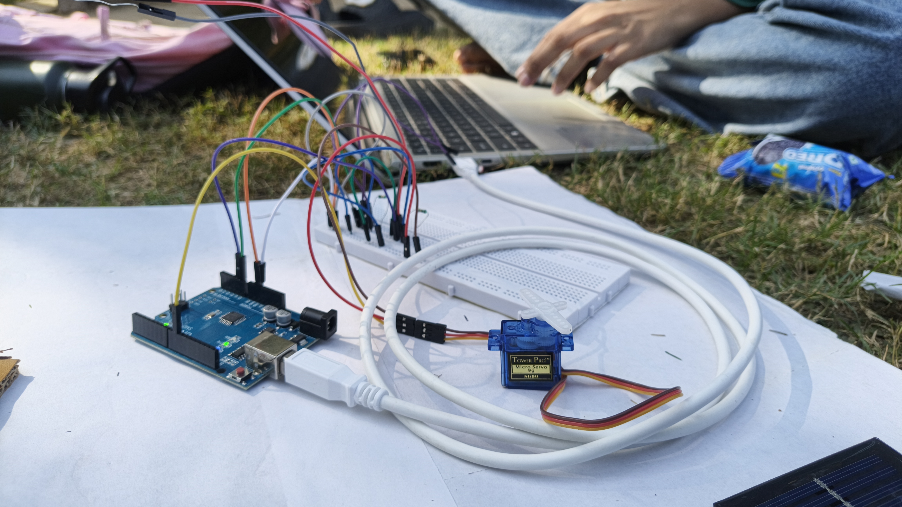
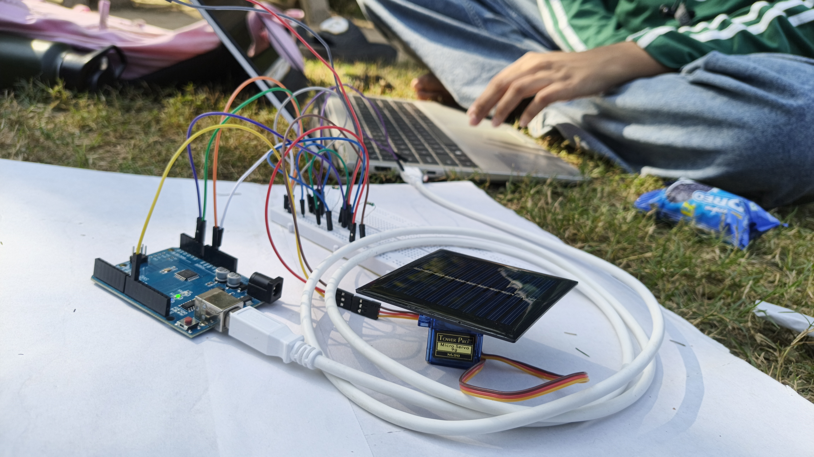
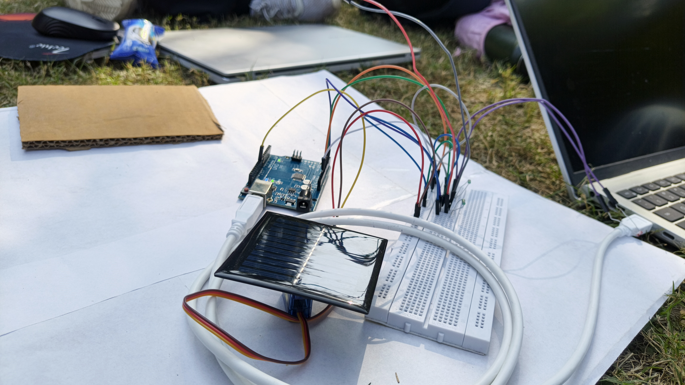

Design and Optimization of Solar Tracking System

Project Overview

This project is a low-cost, automatic single-axis solar tracking system. It uses light sensors to detect the brighter direction and automatically rotates a small solar panel towards it.

Objectives

- Detect light intensity from different directions.
- Automatically adjust solar panel orientation.
- Learn Arduino, sensors, servo control and automation.
- Build a simple and affordable prototype.

Components Used

- Arduino Uno
- 2 × LDR light sensors
- SG90 servo motor
- Mini solar panel
- 10kΩ resistors
- Breadboard and jumper wires

Working Principle

Two LDR sensors detect light from different directions. Arduino compares their readings and controls the servo motor. The servo rotates the solar panel towards the brighter light source. When light readings are nearly equal, the panel stays stable.

Hardware & Technology

- Microcontroller: Arduino Uno
- Sensors: LDR
- Actuator: SG90 Servo Motor
- Programming: Arduino IDE
- Tracking type: Single-axis

Project Photos

### Actual Hardware Prototype

Future Scope

- Dual-axis tracking
- Voltage and current monitoring
- Improved mechanical structure
- Better tracking accuracy

Project Team

Two first-year engineering students.

Project Status

Prototype built and tested successfully. Arduino source code and hardware photographs are available in this repository.
